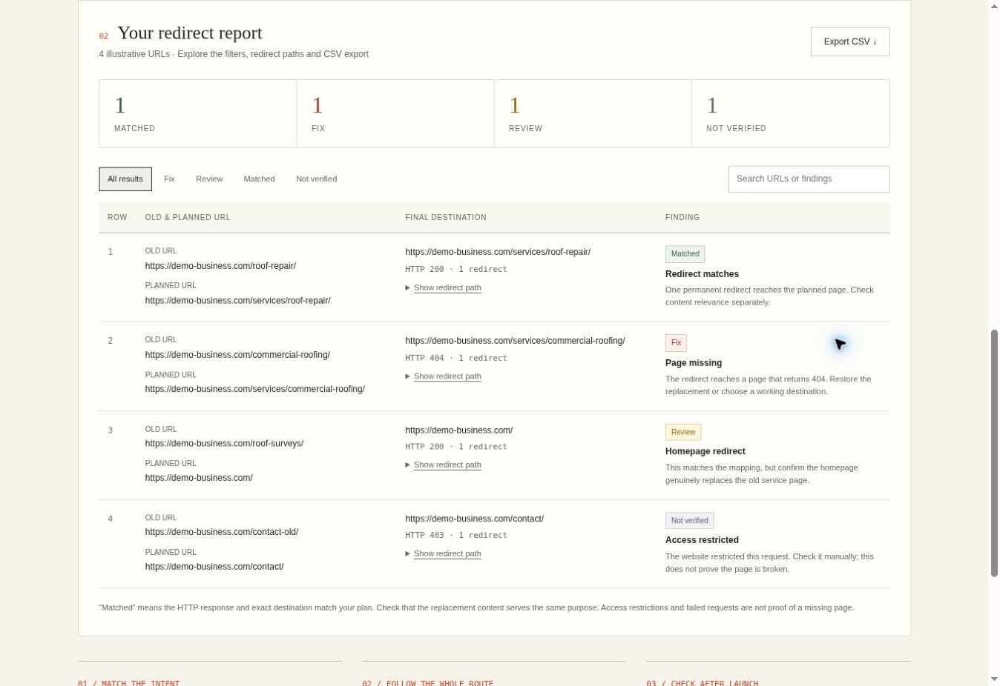

# Migration Redirect Checker

A free website migration redirect checker by [Mark Philpott / Optimize My Websites](https://optimizemywebsites.com/).

**[Use the live checker](https://optimizemywebsites.com/tools/migration-redirect-checker)** · [Read the migration guide](https://optimizemywebsites.com/blog/website-migration-seo)



## What it does

Paste old URLs and planned destinations, or upload a CSV. The checker follows the HTTP redirects, compares the final address against your mapping and produces a downloadable report.

- Up to 50 URL mappings per check.
- Missing redirects, wrong destinations, broken pages and loops.
- Temporary redirects, redirect chains and homepage redirects flagged for review.
- Access restrictions and timeouts marked as not verified.
- Searchable results, filters and CSV export.
- Installable on supported phones and desktops, with an offline app shell.
- No account, paid API, database or analytics required.

The example report uses illustrative data. It is not a live audit of the example domains.

## What it does not verify

A matching redirect does not prove that the replacement content is relevant. This tool does not check Google indexing, rankings, canonical tags or the quality of a migration plan. Destination matching is exact after normal URL parsing and removal of fragments; www, trailing slashes and query parameters matter.

Live checks need an internet connection. Some sites block automated requests or restrict requests from Cloudflare. Those results need manual verification.

## Run locally

Requires Node.js 22 or newer and npm.

```sh
npm install
npm test
npm run dev
```

Open the local address printed by Wrangler. The root redirects to `/tools/migration-redirect-checker`.

## Deploy your own copy

This is a self-contained Cloudflare Worker with no runtime dependencies, storage bindings or application secrets.

```sh
npx wrangler login
npm run deploy
```

Use your own Cloudflare account. Change the Worker name in `wrangler.jsonc` before deployment if needed. Update the branding, canonical URL and site links in `worker/index.js` when adapting the tool to another website.

The page and install assets are under `/tools/migration-redirect-checker`. The check endpoint is `POST /api/tools/migration-redirect-checker` with JSON such as:

```json
{"old":"https://your-domain.com/old-page/","expected":"https://your-domain.com/new-page/"}
```

The service worker controls only the tool path. It caches the app shell and icons, not URL checks or uploaded mappings. The browser keeps the current report in memory; the application does not persist uploads or results. Your hosting provider may retain operational request logs according to your account settings.

## Implementation notes

Each URL check follows at most nine HTTP responses, with a seven-second timeout per request. The browser runs up to three checks concurrently. Basic per-client rate limiting is held in Worker memory and is not durable or shared across isolates. Public deployments may need additional platform-level abuse controls.

The checker rejects IP literals, private-style hostnames, non-HTTP schemes, credentials in URLs and custom ports. These checks are not a general-purpose network security boundary; review your hosting platform's outbound networking protections before adapting it for other uses.

## Repository scope

This repository contains the checker only. It has a fresh history and does not include the main website source, deployment identifiers, account configuration or credentials. The production website is maintained separately.

## Feedback

Use GitHub Issues to report reproducible bugs or suggest improvements. Avoid posting private URL lists or credentials in public issues.
